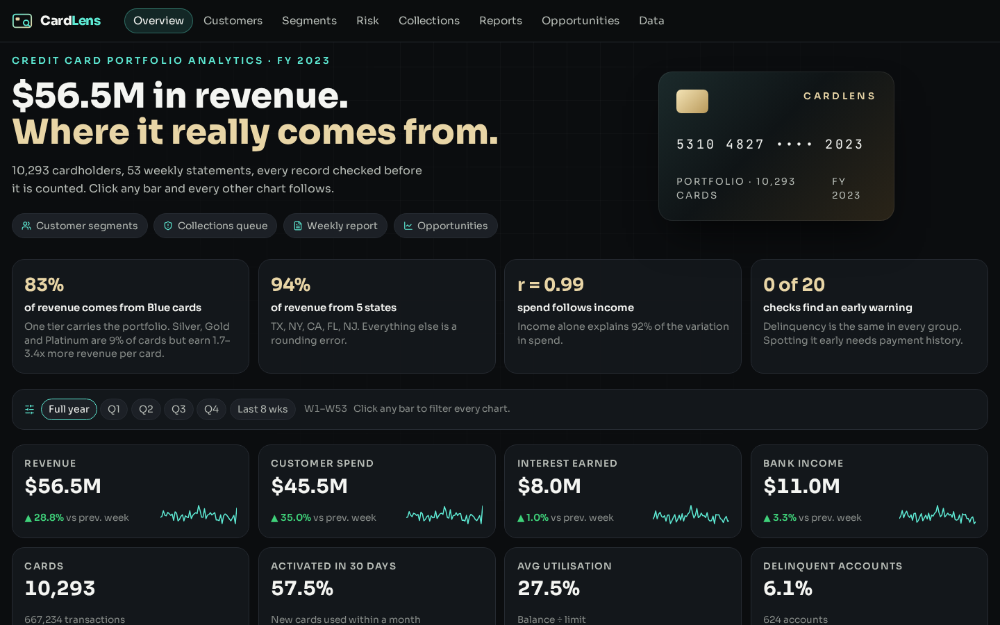
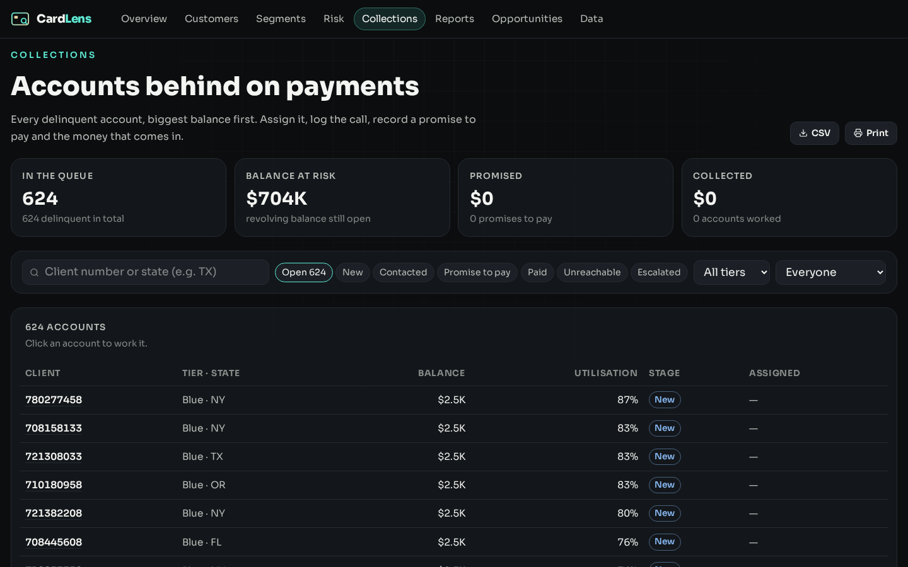
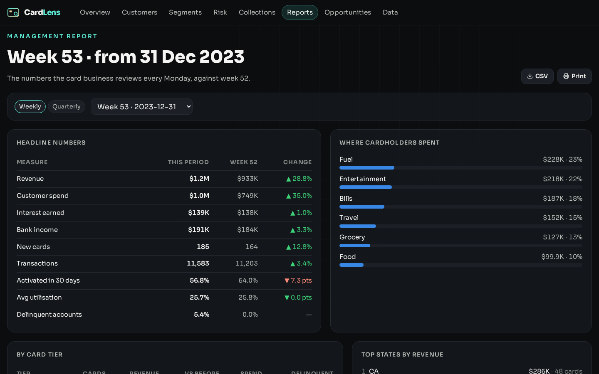
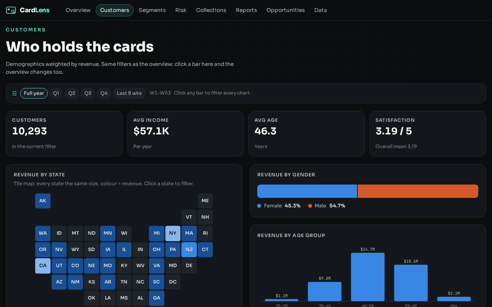
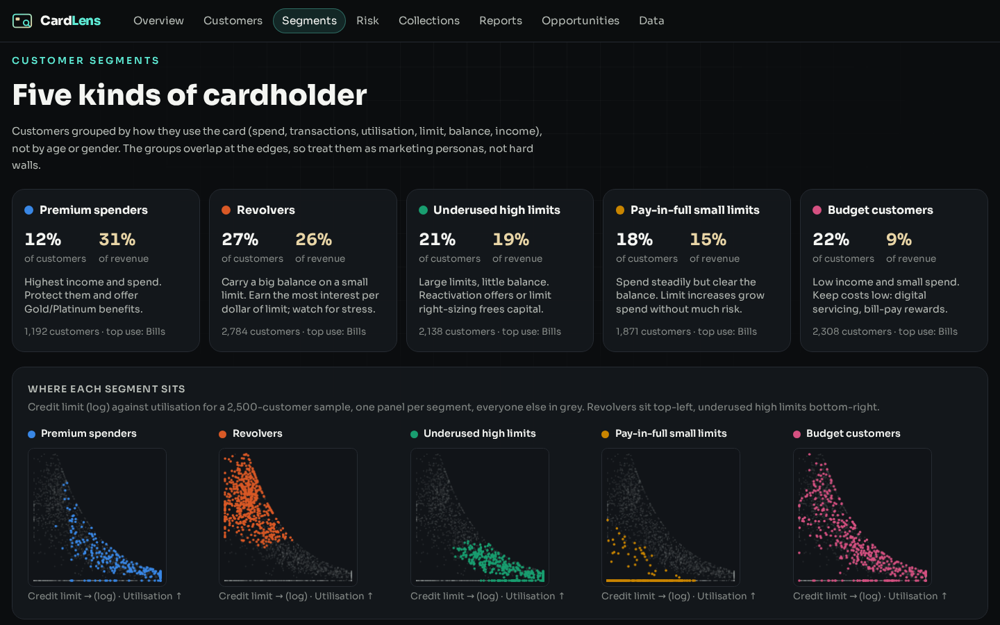
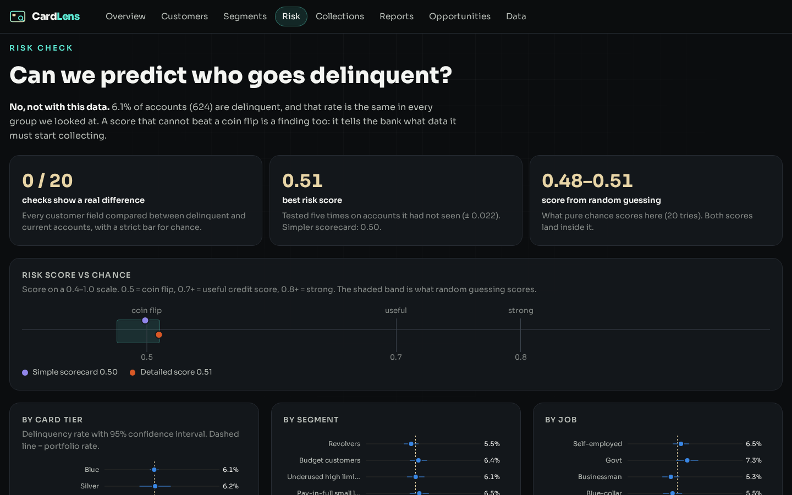
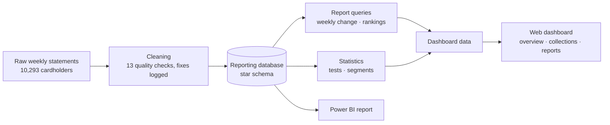

# CardLens

Credit card portfolio analytics for 10,293 cardholders across 53 weekly statements. CardLens
cleans the raw data, finds where the revenue really comes from, tests what can and cannot be
predicted, and gives the bank's teams a dashboard, a collections queue and a weekly report.

**Live:** https://cardlens.twinstackstudio.com

## What it does

- **Overview** — revenue, spend, interest and bank income week by week; every chart filters
  every other chart (tier, quarter, last 8 weeks, a state on the map).
- **Findings** — Blue cards bring 83% of revenue and 5 states bring 94%, while Silver, Gold
  and Platinum earn 1.7 to 3.4 times more per card; spend follows income.
- **Customers** — who holds the cards: income, age, gender, job, satisfaction, a US state map.
- **Segments** — five kinds of cardholder by how they use the card (premium spenders,
  revolvers, underused high limits, pay-in-full small limits, budget customers), with what
  to do for each.
- **Risk** — an honest delinquency test: 20 corrected checks and two scores tested against
  random guessing show this data cannot predict who goes delinquent, and the page says so.
- **Collections queue** — all 624 delinquent accounts, biggest balance first. Assign an
  agent, log calls, record a promise to pay or a payment; every step has a history that can
  be undone. CSV export and a printable call list.
- **Management report** — the weekly or quarterly numbers the card business reviews, with
  change against the previous period, spend by category, tiers and top states; CSV and print.
- **Opportunities** — 1,736 Blue cardholders who already behave like Silver customers.
- **Data** — how the raw files were checked (13 quality checks, every fix logged) and the
  questions behind every chart.
- A matching Power BI report with all measures and a build guide. The layout and type scale
  from a 320 px phone to a 2560 px screen.

| Management report | Customers |
| --- | --- |
|  |  |

| Segments | Risk |
| --- | --- |
|  |  |

## The data, honestly

The data is a public training dataset with fictional customers, not a real bank. Each
customer appears in only one week, so it is a snapshot rather than a full transaction
history. Collections notes in the demo are kept in the viewer's own browser.

## Architecture

## Source code

This is the public showcase. The source code is kept in a private repository. Try the live demo above, and [contact TwinStack Studio](https://twinstackstudio.com/contact) for a walkthrough or a similar project.

© 2026 TwinStack Studio. All rights reserved. See [LICENSE](./LICENSE).
