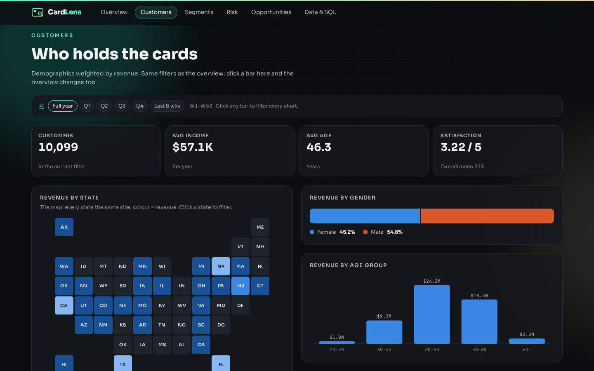
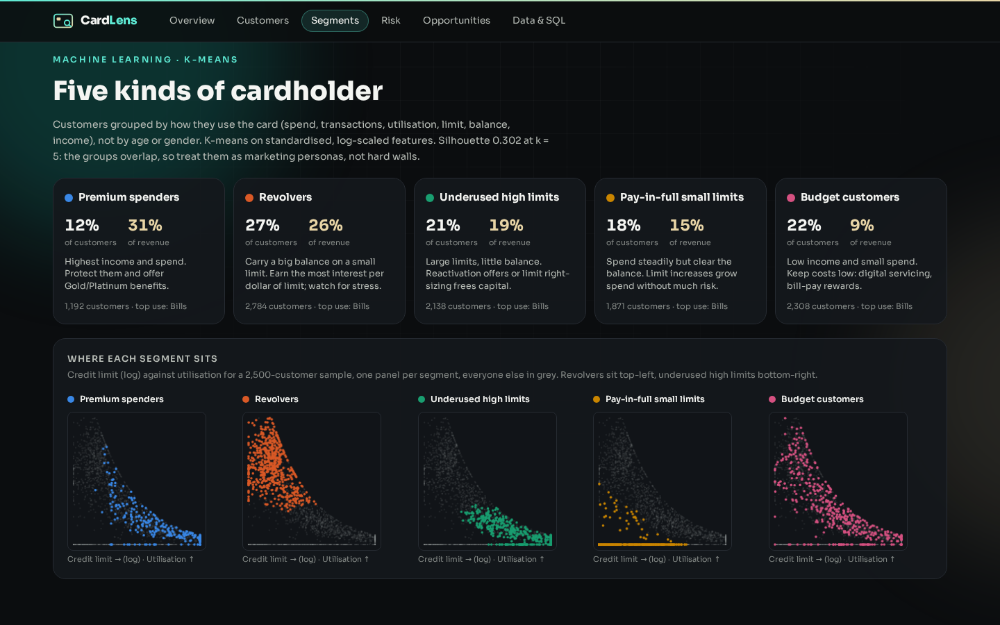
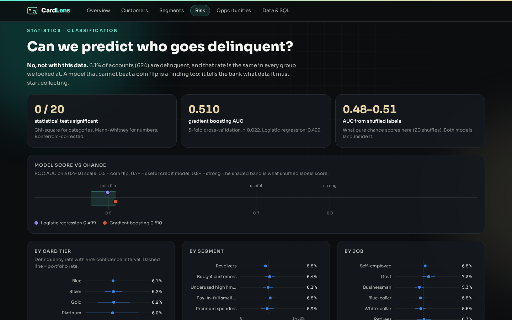
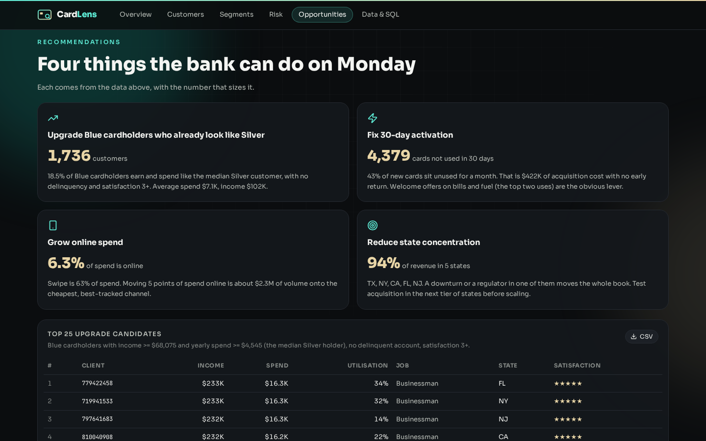
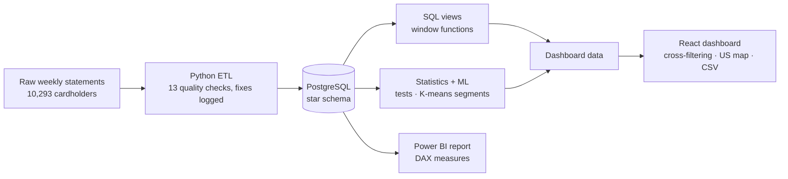

# CardLens

**Data analytics & BI**

Credit card portfolio analytics for 10,293 cardholders across 53 weekly statements. CardLens cleans the raw data, models it in PostgreSQL, tests it with statistics and machine learning, and turns it into a dashboard that shows where the revenue comes from and what the bank should do next.

[**Open the live demo**](https://cardlens.twinstackstudio.com) · [**Work with TwinStack Studio**](https://twinstackstudio.com/contact)

> **Note:** The data is a public training dataset with fictional customers, not a real bank. Each customer appears in only one week, so it is a snapshot rather than a full transaction history.

## What it does

- Python ETL with 13 data quality checks, every fix logged, loaded into a PostgreSQL star schema
- SQL analysis views with window functions: week-over-week change, cumulative revenue, 4-week moving average and state rankings
- Finds that Blue cards bring 83% of revenue and 5 states bring 94%, while Silver, Gold and Platinum earn 1.7 to 3.4 times more per card
- An honest delinquency test: 20 corrected statistical tests and two models checked against shuffled labels show the data cannot predict it
- K-means splits customers into 5 behaviour segments and picks 1,736 Blue cardholders who already look like Silver
- Interactive dashboard where every chart filters every other chart, with a US map, risk view and CSV export
- A matching Power BI version with all DAX measures and a build guide

## Screenshots

| Customers | Segments |
| --- | --- |
|  |  |

| Risk | Opportunities |
| --- | --- |
|  |  |

## Technology

| Layer | Stack |
| --- | --- |
| Data & ML | Python, pandas, SciPy, scikit-learn |
| Database | PostgreSQL, SQL window functions |
| Frontend | React, Vite, Tailwind CSS, Framer Motion |
| BI | Power BI, DAX |

## Architecture

## Source code

This is the public showcase. The source code is kept in a private repository. Try the live demo above, and [contact TwinStack Studio](https://twinstackstudio.com/contact) for a walkthrough or a similar project.

## Built by TwinStack Studio

TwinStack Studio builds full-stack websites, web applications, mobile apps,
dashboards, portals, automation, and AI-powered products.

[GitHub](https://github.com/twinstack-studio) ·
[Website](https://twinstackstudio.com) ·
[Email](mailto:hello@twinstackstudio.com)

© 2026 TwinStack Studio. All rights reserved. See [LICENSE](./LICENSE).
